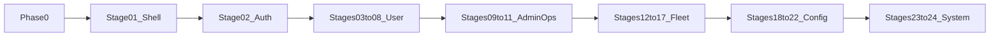

# Поэтапный план редизайна (Grok handoff → Angular) v2

**Дата создания:** 13 октября 2026, 20:19 (UTC+3)  
**Дата изменения:** 21 октября 2026, 15:26 (UTC+3)  
**Handoff:** `[redesign-frontend/](../../redesign-frontend/)` (`STAGES.md`, `ALL-PROMPTS.md`)

**Источник:** `[redesign-frontend/](../../redesign-frontend/)` (24 этапа).  
**Цель:** визуальный порт в `[frontend-angular/](../../frontend-angular/)` по Material 3 (`--mat-sys-`*, 4 темы). Flutter и backend не трогаем.

**v2 (учтены замечания review):** theme/lang на auth brand-панели; 01→02 строго по очереди; миграция footer; сдача = Problems=0 + `ng build` (+ тесты); доп. критерии 01; KPI без цифр; 404/stop-service full-screen; роли в Phase 0; откат только по команде.

## Todos (Phase 0 + 24 этапа)

- [x] Phase 0: канон handoff, чеклист приёмки (роли × темы × viewport), сверка navigationItems, инвентарь footer
- [ ] 01 App Shell (sidenav+toolbar) — блокер; сдача этапа _(gap-close готов; UI-приёмка на паузе — см. [redesign-stage-01-gap.ru.md](redesign-stage-01-gap.ru.md))_
- [ ] 02 AuthShell + login/register/forgot/verify/reset (+ theme/lang на brand); сдача этапа
- [ ] 03 `/main` (KPI = иконка+название+ссылка, без цифр); сдача этапа
- [ ] 04 `/routes`; сдача этапа
- [ ] 05 `/route-builder` (Leaflet без изменений); сдача этапа
- [ ] 06 `/my-freight-requests`; сдача этапа
- [ ] 07 `/profile`; сдача этапа
- [ ] 08 `/my-trips`; сдача этапа
- [ ] 09 `/admin/route-requests`; сдача этапа
- [ ] 10 `/admin/trips` list; сдача этапа
- [ ] 11 `/admin/trips` detail (new/:id); сдача этапа
- [ ] 12 `/admin/vehicles`; сдача этапа
- [ ] 13 `/admin/drivers`; сдача этапа
- [ ] 14 `/admin/vehicle-combinations`; сдача этапа
- [ ] 15 `/admin/currencies`; сдача этапа
- [ ] 16 `/admin/country-reference`; сдача этапа
- [ ] 17 `/admin/document-types`; сдача этапа
- [ ] 18 `/admin/freight-numeric-scenarios`; сдача этапа
- [ ] 19 `/admin/toll-tariff-sets`; сдача этапа
- [ ] 20 `/admin/chatbots`; сдача этапа
- [ ] 21 `/admin/users` (+ `:userId`); сдача этапа
- [ ] 22 `/admin/file-storage-test`; сдача этапа
- [ ] 23 `/404` (full-screen вне shell); сдача этапа
- [ ] 24 `/stop-service` (full-screen вне shell); сдача этапа

## Порядок и параллелизм

**Строго последовательно:** Phase 0 → 01 → 02 → 03 → … → 24.

- Этапы **01 и 02 не параллелить**: оба трогают `app.component`, layout и роутинг — при параллели будут конфликты merge.
- Диаграмма ниже — **зависимости по смыслу** (что блокирует что), не разрешение параллельных Agent-прогонов.
- Один этап = один Agent-прогон. Следующий — только после «+» на приёмку текущего.

## Ворота проверки (после каждого todo / этапа)

Todos = **Phase 0 + 24 этапа** (по одному экрану). Agent сдаёт этап только когда **все** пункты зелёные:

1. **Problems = 0** — ReadLints по изменённым файлам в `frontend-angular/src/`.
2. `npm --prefix frontend-angular run lint:fix` — exit code 0 (если менялся frontend).
3. `npm --prefix frontend-angular run build` — exit code 0 (ловим ошибки шаблонов и lazy-роутов, которые линтер не видит).
4. **Тесты:** если в этапе затронуты/есть релевантные `*.spec.ts` — `npm --prefix frontend-angular run test` с exit code 0; если тестов на затронутые файлы нет — пункт N/A, в отчёте этапа явно написать.
5. **Стоп** — пользователь проверяет UI (desktop/mobile, 4 темы, роли из чеклиста Phase 0) vs `pack/preview-*.png`.
6. Следующий этап — только после явного «+» / «можно дальше».

Не батчить несколько экранов в одном Agent-прогоне.

### Откат / коммиты

- После **принятого** этапа коммит или ветка — **только по явной команде** пользователя (запрет коммитов без просьбы остаётся в силе).
- Рекомендация: один коммит на принятый этап (удобный откат). Agent **не** коммитит сам и не предлагает «заодно закоммитить», пока пользователь не попросит.

## Что в пакете

- У каждого этапа `NN-…/`: корневой `[CURSOR-PROMPT.md](../../redesign-frontend/01-app-shell/CURSOR-PROMPT.md)` (канон для Agent) + `pack/` (HTML/CSS/JS + preview PNG + `pack/README.md`).
- Дубль `pack/CURSOR-PROMPT.md` часто короче/EN — **не** использовать как основной.
- Игнорировать вложенный `[redesign-frontend/geosun-redesign-stages.tar/](../../redesign-frontend/geosun-redesign-stages.tar/)` (дубль архива); работать с плоскими `01-…`…`24-…`.

## Текущий Angular vs прототип

| Слой    | Сейчас                                                                                                                                                                                                              | Прототип                                                                                  |
| ------- | ------------------------------------------------------------------------------------------------------------------------------------------------------------------------------------------------------------------- | ----------------------------------------------------------------------------------------- |
| Chrome  | `[app.component](../../frontend-angular/src/app/app.component.html)` + `[toolbar](../../frontend-angular/src/app/layout/toolbar/)` (горизонтальный nav) + `[footer](../../frontend-angular/src/app/layout/footer/)` | permanent sidenav ≥960 + temporary drawer ≤959, toolbar; footer как отдельный блок уходит |
| Темы    | уже M3 в `[_theme.scss](../../frontend-angular/src/styles/_theme.scss)` + `[ThemeService](../../frontend-angular/src/app/core/services/theme.service.ts)`                                                           | те же 4 класса `theme-*`                                                                  |
| i18n    | `uk.json` / `en.json` / `ru.json`                                                                                                                                                                                   | то же (`uk`, не `ua`)                                                                     |
| `/main` | title + welcome + role banners                                                                                                                                                                                      | + KPI strip + quick actions + activity empty                                              |

**Зафиксированные решения плана:**

1. **i18n:** оставляем прод-коды `uk`/`en`/`ru` (как в handoff и в Angular). Rename `uk→ua` — отдельная задача, не в редизайне.
2. `/main` **(этап 03) — KPI без фейковых цифр:** карточки KPI = **только иконка + название + ссылка** (навигация по роли). Счётчики/цифры **не** показывать и **не** выдумывать. Новые API не добавлять. Если позже появятся реальные эндпоинты — отдельная задача. Role banners сохраняем по смыслу внутри hero. Quick actions и activity empty — из прототипа на существующих i18n/роутах.
3. **Footer (миграция, не потеря):** инвентарь текущего `[footer.component.html](../../frontend-angular/src/app/layout/footer/footer.component.html)`:
  - **Гость:** `©` + `common.designedBy`, соцсети (Telegram/WhatsApp/Viber/Facebook/LinkedIn), кнопка App Info (`AppInfoDialogComponent` — версия клиента/сервера).
  - **Залогиненный:** email + role (после shell это дубль user-menu в toolbar).
  - **Куда переносить:**
    - Authenticated shell: copyright + кнопка App Info → **низ sidenav** (`sidenav-footer`); email/role — только в user menu toolbar (не дублировать).
    - Guest/AuthShell: соцсети + copyright + App Info — на **бренд-панели** AuthShell (или низ brand strip на mobile), не на белом form sheet.
  - Старый `<app-footer>` из `app.component` убрать только после переноса содержимого.
4. **Breakpoint shell:** 960px как в handoff; у route-builder сохраняем прод-compact `1099.98px` для split panel/map.
5. **Auth theme/lang (этап 02):** демо-реализацию прототипа (localStorage `geosun-auth-`*, fake chrome) **не** копировать. Переключатели темы и языка **оставить на бренд-панели** (desktop: brand panel; mobile: brand strip) и подключить к существующим `ThemeService` и **ngx-translate** — гость на `/login` (и остальных auth) должен менять язык/тему.
6. **404 / stop-service (23–24):** **на весь экран вне AppShell** (и гость, и залогиненный). Pack этапа 23 показывает shell как framing для превью; продуктово — full-screen status-card (как текущие верхнеуровневые routes без shell-обёртки после 01). CTA 404 → `/main` (или `/login` для гостя — сохранить текущее поведение роута/ссылок).
7. **Процесс:** один этап = один todo = один Agent-прогон; приёмка пользователем → следующий. Код только после явного «+» на этот план (и далее — на старт этапа 01).
8. **Откат:** коммит/ветка после принятого этапа — только по команде пользователя.

## Общие правила каждого этапа

- Только `frontend-angular`; Material tokens; **без** `::ng-deep`.
- Не клонировать HTML в static assets; не менять API/guards/roles/формы вне UI.
- 4 темы + desktop/mobile; новые i18n-ключи — во все три JSON (`uk`/`en`/`ru`).
- Приёмка: скриншоты `pack/preview-*.png` + ручная проверка 4 тем × 2 viewport × роли из Phase 0.
- Сдача этапа: см. **Ворота проверки** выше (Problems=0 + lint:fix + build + тесты при наличии).
- Канон промпта: `redesign-frontend/NN-…/CURSOR-PROMPT.md` + скрины из `pack/`.

---

## Phase 0 — Preflight (без кода UI)

- Зафиксировать рабочий вход: плоские `redesign-frontend/01…24`, не tar-дубль.
- Сверить `[navigationItems](../../frontend-angular/src/app/layout/toolbar/toolbar.component.ts)` с меню в `[01-app-shell/pack/README.md](../../redesign-frontend/01-app-shell/pack/README.md)`.
- **Инвентарь footer** (см. решение №3) — зафиксировать целевые слоты (sidenav-footer / AuthShell brand) до кода этапа 01–02.
- Подготовить **чеклист приёмки** на каждый этап:

### Роли для приёмки (явно)

| Роль        | Кто                 | Что смотреть                                                                 |
| ----------- | ------------------- | ---------------------------------------------------------------------------- |
| **guest**   | не залогинен        | auth-страницы; `/404` full-screen; нет AppShell                              |
| **user**    | `UserRole = 'user'` | user-nav, `/main` KPI/quick под user, свои списки                            |
| **driver**  | `'driver'`          | nav driver (вкл. my-trips), `/main` под driver                               |
| **manager** | `'manager'`         | admin ops без чисто-admin пунктов (напр. document-types / file-storage-test) |
| **admin**   | `'admin'`           | полный admin-nav + admin-секции `/main`                                      |

На каждом этапе проверять **релевантные** роли (не все 5, если экран недоступен роли), плюс:

- 4 темы × desktop (≥960) × mobile (≤959);
- i18n uk / en / ru на видимых строках этапа.
- Опционально: локальный `python -m http.server` в `pack/` для интерактива.
- **Стоп** на подтверждение чеклиста.

---

## Этап 01 — App Shell — блокер для 02–22

**Промпт:** `[01-app-shell/CURSOR-PROMPT.md](../../redesign-frontend/01-app-shell/CURSOR-PROMPT.md)`

- Вынести authenticated layout: `layout/app-shell` + sidenav + обновлённый toolbar; guest/auth и system pages (**404, stop-service**) **вне** shell.
- Перенести `navigationItems` + role filter; **заголовок toolbar из** `route data` (или эквивалент по активному route) — при необходимости **новые i18n-ключи во все три JSON**.
- Theme/lang/user menu в toolbar; mobile hamburger → temporary drawer + scrim.
- **Мобильный drawer:** закрывается при переходе по ссылке навигации (и по scrim / Escape — как в Material).
- **a11y гамбургера:** фокус-менеджмент (открытие → фокус в drawer; закрытие → возврат на кнопку), `aria-expanded`, `aria-controls`, `aria-label` (i18n).
- Перенос **sidenav-footer**: copyright + App Info (из текущего footer); не терять версию/диалог.
- Правки роутинга только структура layout/`router-outlet` в `[app.routes.ts](../../frontend-angular/src/app/app.routes.ts)` / `app.component` — **без** новых path.
- Не редизайнить тела страниц.
- **Стоп** на UI-приёмку + ворота сдачи.

**Риск:** самый крупный layout-рефакторинг; page-loading progress и role-switch должны остаться рабочими.

---

## Этап 02 — Guest Auth — строго после 01

**Промпт:** `[02-auth/CURSOR-PROMPT.md](../../redesign-frontend/02-auth/CURSOR-PROMPT.md)`

- Routes: `/login`, `/register`, `/forgot-password`, `/verify-email`, `/reset-password`.
- Выделить shared **AuthShell** (сейчас только `.auth-page` в `[_page-layout.scss](../../frontend-angular/src/styles/_page-layout.scss)`).
- Desktop split ~42/58; mobile brand strip + sheet; не ломать `AuthService` / error mapping.
- **Theme/lang:** выкинуть демо-реализацию прототипа; **вывести переключатели на бренд-панель**, подключить к `ThemeService` + Translate. Гость обязан иметь смену языка на `/login`.
- Перенести guest-часть footer (соцсети, copyright, App Info) на brand-панель, если ещё не сделано в 01.
- **Стоп** на UI-приёмку + ворота сдачи.

> Примечание: корневой `CURSOR-PROMPT.md` этапа 02 говорит «demo pickers НЕ в прод» — для Agent в чате **переопределять** формулировкой этого плана: pickers в прод на brand-панели, без demo localStorage/логики.

---

## Этапы 03–08 — User pages (строго после 02; каждый — отдельный todo)

| Todo | Route                  | Angular                                                     | Заметки                                                                   |
| ---- | ---------------------- | ----------------------------------------------------------- | ------------------------------------------------------------------------- |
| 03   | `/main`                | `[pages/main/](../../frontend-angular/src/app/pages/main/)` | KPI = иконка+title+link **без цифр**; quick/activity; role banners в hero |
| 04   | `/routes`              | `pages/routes/`                                             | list + empty                                                              |
| 05   | `/route-builder`       | `pages/route-builder/`                                      | restyle panel+outlet; **Leaflet не менять**                               |
| 06   | `/my-freight-requests` | `pages/my-freight-requests/`                                |                                                                           |
| 07   | `/profile`             | `pages/profile/`                                            |                                                                           |
| 08   | `/my-trips`            | `pages/my-trips/`                                           | pack на `page-kit`; нет magenta-preview — темы всё равно проверить        |

---

## Этапы 09–11 — Admin operations (каждый отдельно)

| Todo | Route                      | Заметки                                                                                                         |
| ---- | -------------------------- | --------------------------------------------------------------------------------------------------------------- |
| 09   | `/admin/route-requests`    | локальный mat-sidenav страницы не путать с app shell                                                            |
| 10   | `/admin/trips`             | **только list**                                                                                                 |
| 11   | `/admin/trips/new`, `/:id` | **только detail** (`[admin-trip-detail](../../frontend-angular/src/app/pages/admin-trips/)`); не смешивать с 10 |

---

## Этапы 12–17 — Fleet & catalog (по одному todo)

vehicles → drivers → combinations → currencies → country-reference → document-types.  
Опираться на `[_admin-list-toolbar.scss](../../frontend-angular/src/styles/_admin-list-toolbar.scss)`, `frontend-ui.ru.mdc`. После каждого — стоп + ворота сдачи.

---

## Этапы 18–22 — Admin config & tools (по одному todo)

freight-numeric-scenarios → toll-tariff-sets → chatbots → users (+ `:userId`) → file-storage-test.

---

## Этапы 23–24 — System pages (full-screen вне shell)

- 23: `/404` — `[pages/not-found/](../../frontend-angular/src/app/pages/not-found/)` — центрированная status-card, **вне** AppShell.
- 24: `/stop-service` — `[pages/stop-service/](../../frontend-angular/src/app/pages/stop-service/)` — то же.  
Проверить и guest, и authenticated (chrome shell не должен «просвечивать»).

---

## Как запускать этап в Cursor

1. Открыть `redesign-frontend/NN-…/CURSOR-PROMPT.md` (текст ниже `---`).
2. Приложить `pack/preview-*.png` (+ при необходимости `pack/README.md`).
3. В чате явно дописать дельты этого плана, если они **перекрывают** формулировку промпта (особенно 02 theme/lang, 03 KPI без цифр, 23–24 full-screen).
4. После ворот сдачи и вашей приёмки («+») — следующий номер.
5. Коммит принятого этапа — только если вы явно попросили.

## Вне скоупа всего редизайна

- Backend, новые бизнес-API, Flutter.
- Копирование demo-данных / demo role switcher / demo KPI-цифр прототипа.
- Переписывание ThemeService / Translate setup «с нуля» (только подключить существующие).
- Массовый rename `uk` → `ua`.
- Коммит/push без явной просьбы.
- Параллельные Agent-прогоны этапов 01 и 02 (или любых двух этапов).

