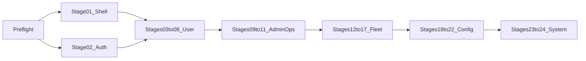

# Поэтапный план редизайна (Grok handoff → Angular)

**Дата создания:** 13 октября 2026, 20:19 (UTC+3)  
**Дата изменения:** 13 октября 2026, 20:25 (UTC+3)  
**Handoff:** [`redesign-frontend/`](../../redesign-frontend/) (`STAGES.md`, `ALL-PROMPTS.md`)

**Источник:** [`redesign-frontend/`](../../redesign-frontend/) (24 этапа).  
**Цель:** визуальный порт в [`frontend-angular/`](../../frontend-angular/) по Material 3 (`--mat-sys-*`, 4 темы). Flutter и backend не трогаем.

## Todos (Phase 0 + 24 этапа)

- [ ] Phase 0: канон handoff, чеклист приёмки, сверка navigationItems
- [ ] 01 App Shell (sidenav+toolbar) — блокер; ReadLints/Problems=0
- [ ] 02 AuthShell + login/register/forgot/verify/reset; Problems=0
- [ ] 03 `/main` (KPI/quick/activity UI без fake metrics); Problems=0
- [ ] 04 `/routes`; Problems=0
- [ ] 05 `/route-builder` (Leaflet без изменений); Problems=0
- [ ] 06 `/my-freight-requests`; Problems=0
- [ ] 07 `/profile`; Problems=0
- [ ] 08 `/my-trips`; Problems=0
- [ ] 09 `/admin/route-requests`; Problems=0
- [ ] 10 `/admin/trips` list; Problems=0
- [ ] 11 `/admin/trips` detail (new/:id); Problems=0
- [ ] 12 `/admin/vehicles`; Problems=0
- [ ] 13 `/admin/drivers`; Problems=0
- [ ] 14 `/admin/vehicle-combinations`; Problems=0
- [ ] 15 `/admin/currencies`; Problems=0
- [ ] 16 `/admin/country-reference`; Problems=0
- [ ] 17 `/admin/document-types`; Problems=0
- [ ] 18 `/admin/freight-numeric-scenarios`; Problems=0
- [ ] 19 `/admin/toll-tariff-sets`; Problems=0
- [ ] 20 `/admin/chatbots`; Problems=0
- [ ] 21 `/admin/users` (+ `:userId`); Problems=0
- [ ] 22 `/admin/file-storage-test`; Problems=0
- [ ] 23 `/404`; Problems=0
- [ ] 24 `/stop-service`; Problems=0

## Ворота проверки (после каждого todo)

Todos = **Phase 0 + 24 этапа** (по одному экрану). После завершения todo:

1. Agent сдаёт этап только при **Problems = 0** (ReadLints по изменённым Angular-файлам).
2. **Стоп** — пользователь проверяет UI (desktop/mobile, 4 темы, роли) vs `pack/preview-*.png`.
3. Следующий этап стартует только после явного «+» / «можно дальше».

Не батчить несколько экранов в одном Agent-прогоне.

## Что в пакете

- У каждого этапа `NN-…/`: корневой [`CURSOR-PROMPT.md`](../../redesign-frontend/01-app-shell/CURSOR-PROMPT.md) (канон для Agent) + `pack/` (HTML/CSS/JS + preview PNG + `pack/README.md`).
- Дубль `pack/CURSOR-PROMPT.md` часто короче/EN — **не** использовать как основной.
- Игнорировать вложенный [`redesign-frontend/geosun-redesign-stages.tar/`](../../redesign-frontend/geosun-redesign-stages.tar/) (дубль архива); работать с плоскими `01-…`…`24-…`.

## Текущий Angular vs прототип

| Слой | Сейчас | Прототип |
|------|--------|----------|
| Chrome | [`app.component`](../../frontend-angular/src/app/app.component.html) + [`toolbar`](../../frontend-angular/src/app/layout/toolbar/) (горизонтальный nav) + [`footer`](../../frontend-angular/src/app/layout/footer/) | permanent sidenav ≥960 + temporary drawer ≤959, toolbar без footer |
| Темы | уже M3 в [`_theme.scss`](../../frontend-angular/src/styles/_theme.scss) + [`ThemeService`](../../frontend-angular/src/app/core/services/theme.service.ts) | те же 4 класса `theme-*` |
| i18n | `uk.json` / `en.json` / `ru.json` | то же (`uk`, не `ua`) |
| `/main` | title + welcome + role banners | + KPI strip + quick actions + activity empty |

**Зафиксированные решения плана:**

1. **i18n:** оставляем прод-коды `uk`/`en`/`ru` (как в handoff и в Angular). Rename `uk→ua` — отдельная задача, не в редизайне.
2. **`/main` (этап 03):** порт UI-структуры прототипа (hero, KPI-карточки как навигация, quick actions, activity empty) на существующих ключах/роутах; **без** демо-цифр и без новых API. Role banners сохраняем по смыслу внутри hero.
3. **Footer:** в authenticated shell убираем/скрываем, как в прототипе; guest/auth — по AuthShell этапа 02.
4. **Breakpoint shell:** 960px как в handoff; у route-builder сохраняем прод-compact `1099.98px` для split panel/map.
5. **Процесс:** один этап = один todo = один Agent-прогон; приёмка пользователем → следующий. Код только после явного «+» на этот план (и далее — на старт этапа 01).

## Общие правила каждого этапа

- Только `frontend-angular`; Material tokens; **без** `::ng-deep`.
- Не клонировать HTML в static assets; не менять API/guards/roles/формы вне UI.
- 4 темы + desktop/mobile; новые i18n-ключи — во все три JSON.
- Приёмка: скриншоты `pack/preview-*.png` + ручная проверка 4 тем.
- Сдача этапа: `lint:fix` / ReadLints по изменённым файлам, **Problems = 0**; exit code команд = 0.
- Канон промпта: `redesign-frontend/NN-…/CURSOR-PROMPT.md` + скрины из `pack/`.

---

## Phase 0 — Preflight (без кода UI)

- Зафиксировать рабочий вход: плоские `redesign-frontend/01…24`, не tar-дубль.
- Сверить [`navigationItems`](../../frontend-angular/src/app/layout/toolbar/toolbar.component.ts) с меню в [`01-app-shell/pack/README.md`](../../redesign-frontend/01-app-shell/pack/README.md).
- Подготовить чеклист приёмки этапа (темы × 2 viewport × роли).
- Опционально: локальный `python -m http.server` в `pack/` для интерактива.
- **Стоп** на подтверждение чеклиста.

---

## Этап 01 — App Shell — блокер для 03–22

**Промпт:** [`01-app-shell/CURSOR-PROMPT.md`](../../redesign-frontend/01-app-shell/CURSOR-PROMPT.md)

- Вынести authenticated layout: `layout/app-shell` + sidenav + обновлённый toolbar; guest вне shell.
- Перенести `navigationItems` + role filter; title из активного route.
- Theme/lang/user menu в toolbar; mobile hamburger → temporary drawer + scrim.
- Правки роутинга только структура layout/`router-outlet` в [`app.routes.ts`](../../frontend-angular/src/app/app.routes.ts) / `app.component` — **без** новых path.
- Не редизайнить тела страниц.
- **Стоп** на UI-приёмку.

**Риск:** самый крупный layout-рефакторинг; page-loading progress и role-switch должны остаться рабочими.

---

## Этап 02 — Guest Auth — можно после/параллельно с 01 при согласованных темах

**Промпт:** [`02-auth/CURSOR-PROMPT.md`](../../redesign-frontend/02-auth/CURSOR-PROMPT.md)

- Routes: `/login`, `/register`, `/forgot-password`, `/verify-email`, `/reset-password`.
- Выделить shared **AuthShell** (сейчас только `.auth-page` в [`_page-layout.scss`](../../frontend-angular/src/styles/_page-layout.scss)).
- Desktop split ~42/58; mobile brand strip + sheet; не ломать `AuthService` / error mapping.
- Demo theme/lang pickers прототипа **не** в прод.
- **Стоп** на UI-приёмку.

---

## Этапы 03–08 — User pages (строго после 01; каждый — отдельный todo)

| Todo | Route | Angular | Заметки |
|------|-------|---------|---------|
| 03 | `/main` | [`pages/main/`](../../frontend-angular/src/app/pages/main/) | UI KPI/quick/activity без fake metrics |
| 04 | `/routes` | `pages/routes/` | list + empty |
| 05 | `/route-builder` | `pages/route-builder/` | restyle panel+outlet; **Leaflet не менять** |
| 06 | `/my-freight-requests` | `pages/my-freight-requests/` | |
| 07 | `/profile` | `pages/profile/` | |
| 08 | `/my-trips` | `pages/my-trips/` | pack на `page-kit`; нет magenta-preview — темы всё равно проверить |

---

## Этапы 09–11 — Admin operations (каждый отдельно)

| Todo | Route | Заметки |
|------|-------|---------|
| 09 | `/admin/route-requests` | локальный mat-sidenav страницы не путать с app shell |
| 10 | `/admin/trips` | **только list** |
| 11 | `/admin/trips/new`, `/:id` | **только detail** ([`admin-trip-detail`](../../frontend-angular/src/app/pages/admin-trips/)); не смешивать с 10 |

---

## Этапы 12–17 — Fleet & catalog (по одному todo)

vehicles → drivers → combinations → currencies → country-reference → document-types.  
Опираться на [`_admin-list-toolbar.scss`](../../frontend-angular/src/styles/_admin-list-toolbar.scss), `frontend-ui.ru.mdc`. После каждого — стоп.

---

## Этапы 18–22 — Admin config & tools (по одному todo)

freight-numeric-scenarios → toll-tariff-sets → chatbots → users (+ `:userId`) → file-storage-test.

---

## Этапы 23–24 — System pages

- 23: `/404` — [`pages/not-found/`](../../frontend-angular/src/app/pages/not-found/)
- 24: `/stop-service` — [`pages/stop-service/`](../../frontend-angular/src/app/pages/stop-service/)  
Могут быть вне/поверх shell — как в текущем роутинге.

---

## Как запускать этап в Cursor

1. Открыть `redesign-frontend/NN-…/CURSOR-PROMPT.md` (текст ниже `---`).
2. Приложить `pack/preview-*.png` (+ при необходимости `pack/README.md`).
3. После Problems=0 и вашей приёмки («+») — следующий номер.

## Вне скоупа всего редизайна

- Backend, новые бизнес-API, Flutter.
- Копирование demo-данных / demo role switcher прототипа.
- Переписывание ThemeService / Translate setup «с нуля».
- Массовый rename `uk` → `ua`.
- Коммит/push без явной просьбы.
